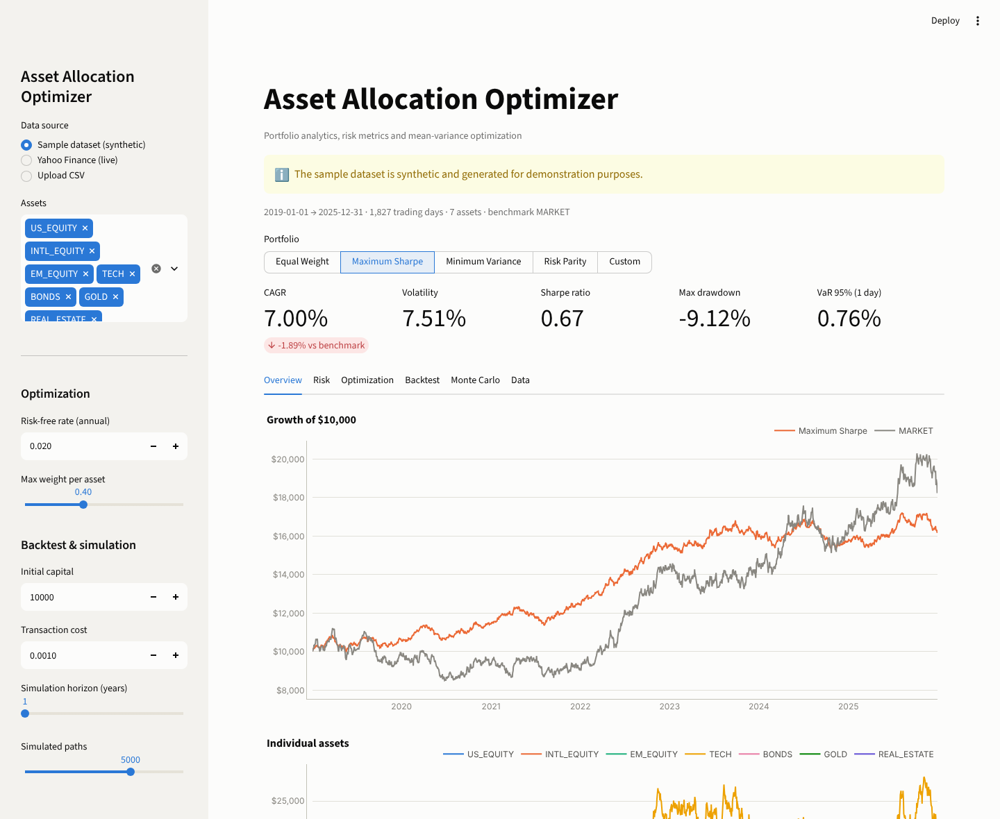
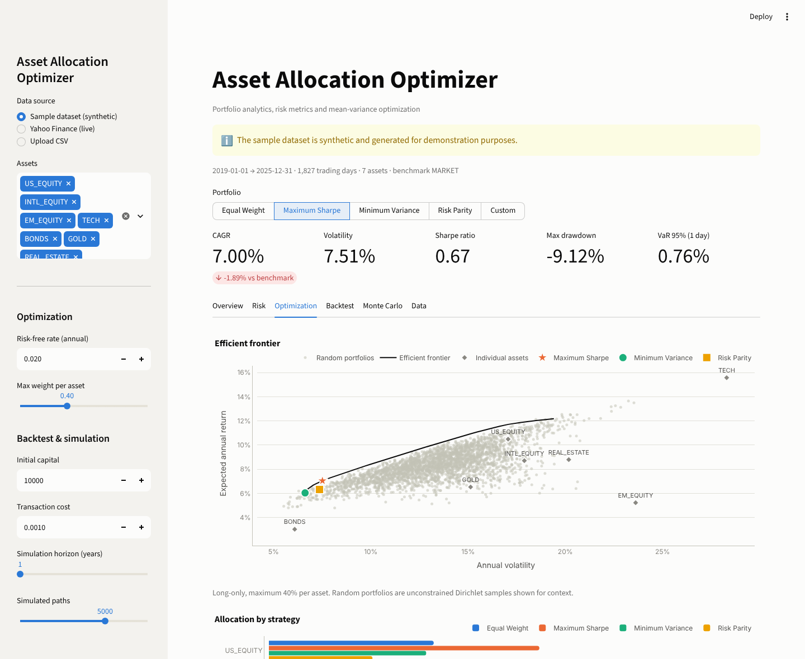
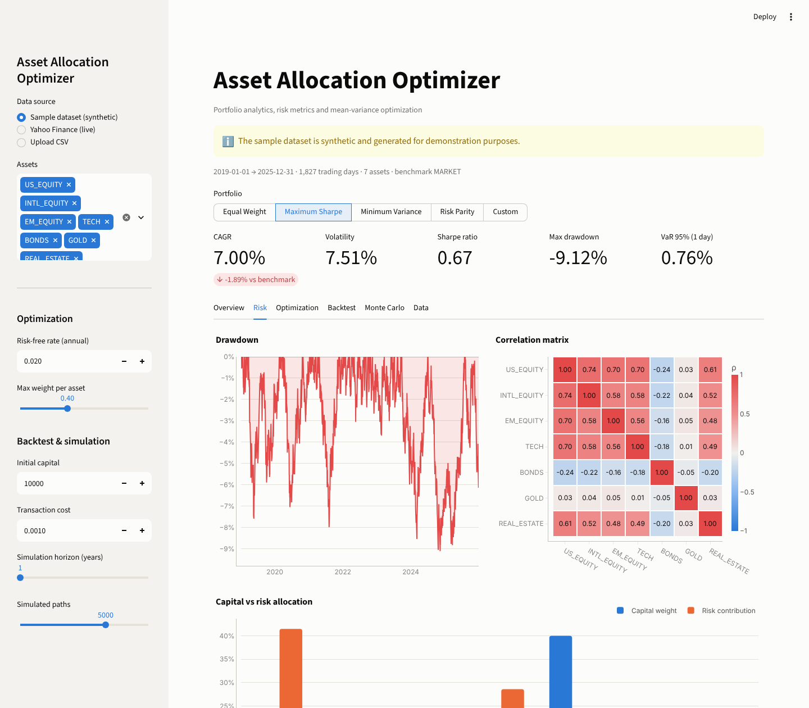
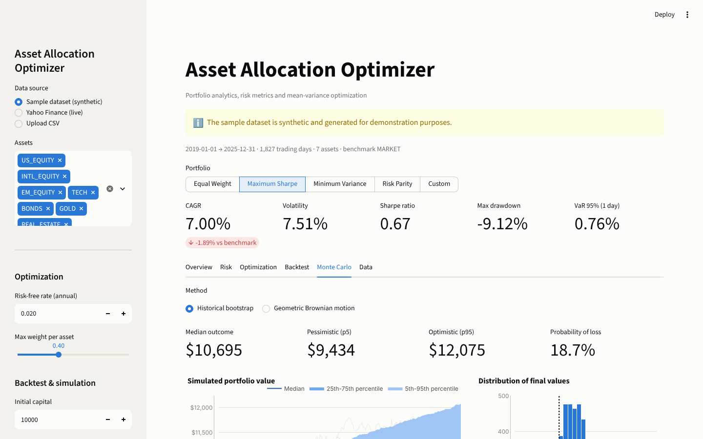
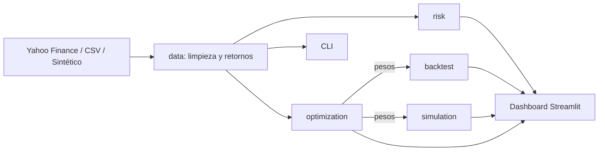

# Asset Allocation Optimizer


[](https://github.com/cawtterminal/asset-allocation-optimizer/actions/workflows/ci.yml)

Librería de **análisis y optimización de portafolios de inversión** con un **dashboard interactivo** en Streamlit. Descarga precios reales desde Yahoo Finance, calcula métricas de riesgo profesionales, construye la **frontera eficiente de Markowitz**, compara políticas de rebalanceo con costos de transacción y proyecta escenarios futuros con **simulación Monte Carlo**.

> Proyecto educativo. No constituye asesoramiento financiero.



---

## Tabla de contenidos

- [Características](#características)
- [Capturas](#capturas)
- [Arquitectura](#arquitectura)
- [Modelos financieros](#modelos-financieros)
- [Instalación](#instalación)
- [Uso](#uso)
- [Usar la librería desde código](#usar-la-librería-desde-código)
- [Tests y calidad](#tests-y-calidad)
- [Deploy gratuito](#deploy-gratuito)
- [Decisiones de diseño](#decisiones-de-diseño)
- [Roadmap](#roadmap)

---

## Características

- **Tres fuentes de datos**: Yahoo Finance en vivo, CSV propio o un dataset sintético incluido para probar sin conexión.
- **4 estrategias de asignación**: pesos iguales, mínima varianza, máximo Sharpe (portafolio tangente) y paridad de riesgo, más pesos personalizados editables en la app.
- **Restricciones realistas**: solo posiciones largas y peso máximo por activo, para evitar carteras concentradas.
- **Frontera eficiente** calculada por optimización cuadrática y comparada con 3.000 portafolios aleatorios.
- **14 métricas de riesgo**: CAGR, volatilidad, Sharpe, Sortino, Calmar, máximo drawdown, VaR y CVaR al 95 %, beta, alfa de Jensen, tracking error e information ratio.
- **Backtest de rebalanceo**: compara nunca, mensual, trimestral y anual, con costos de transacción y turnover.
- **Monte Carlo**: bootstrap histórico o movimiento browniano geométrico, con bandas de percentiles y probabilidad de pérdida.
- **Descomposición del riesgo**: contribución de cada activo al riesgo total frente a su peso en capital.
- **CLI** para correr el análisis completo desde la terminal.
- **65 tests** con pytest y **94 % de cobertura** (incluye tests de la app con `streamlit.testing`), linter Ruff y CI en GitHub Actions sobre Python 3.11, 3.12 y 3.13.

---

## Capturas

### Frontera eficiente



### Riesgo: drawdown, correlaciones y contribución al riesgo



### Simulación Monte Carlo



---

## Arquitectura

```
asset-allocation-optimizer/
├── app/
│   └── streamlit_app.py        Dashboard interactivo
├── src/asset_allocation_optimizer/
│   ├── data.py                 Proveedores de datos (Yahoo, CSV, sintético) y limpieza
│   ├── portfolio.py            Retornos de cartera, covarianza, contribución al riesgo
│   ├── risk.py                 Métricas de riesgo y performance
│   ├── optimization.py         Mínima varianza, máximo Sharpe, paridad de riesgo, frontera
│   ├── backtest.py             Simulación de rebalanceo con costos
│   ├── simulation.py           Monte Carlo
│   ├── charts.py               Gráficos Plotly con paleta accesible
│   └── cli.py                  Interfaz de línea de comandos
├── tests/                      Suite de pytest
├── data/sample_prices.csv      Dataset sintético de ejemplo
└── docs/images/                Capturas del README
```



La lógica financiera vive en el paquete `asset_allocation_optimizer` y no depende de Streamlit: la app y el CLI son dos interfaces sobre la misma librería, que se puede testear y reutilizar por separado.

---

## Modelos financieros

| Modelo | Implementación |
|---|---|
| Retornos esperados | Media histórica anualizada (252 ruedas) |
| Riesgo | Matriz de covarianza muestral anualizada |
| Mínima varianza | `min wᵀΣw` sujeto a `Σw = 1`, `0 ≤ w ≤ máx` (SLSQP) |
| Máximo Sharpe | `max (wᵀμ − r_f) / √(wᵀΣw)` con las mismas restricciones |
| Paridad de riesgo | Formulación convexa de Spinu: `min ½ yᵀΣy − (1/n) Σ log yᵢ`, normalizada |
| Frontera eficiente | Mínima varianza para cada retorno objetivo entre el mínimo y el máximo alcanzable |
| VaR / CVaR | Histórico y paramétrico (normal); CVaR como pérdida media en la cola |
| Alfa y beta | CAPM sobre el benchmark elegido |
| Rebalanceo | Pesos que derivan con el mercado y vuelven al objetivo al cierre de cada período, cobrando costo sobre el monto operado |
| Monte Carlo | Bootstrap de retornos diarios históricos o GBM con media y volatilidad estimadas |

---

## Instalación

Requiere Python 3.11 o superior.

```bash
git clone https://github.com/TU_USUARIO/asset-allocation-optimizer.git
cd asset-allocation-optimizer
python -m venv .venv
source .venv/bin/activate        # En Windows: .venv\Scripts\activate
pip install -e ".[dev]"
```

---

## Uso

### Dashboard

```bash
streamlit run app/streamlit_app.py
```

Se abre en `http://localhost:8501`. Desde la barra lateral se elige la fuente de datos, los activos, la tasa libre de riesgo, el peso máximo por activo, el capital y el horizonte de simulación.

Para usar datos reales elegí **Yahoo Finance (live)** y escribí los tickers, por ejemplo `AAPL, MSFT, NVDA, JPM, XOM, GLD, TLT` con benchmark `SPY`.

### Línea de comandos

```bash
asset-allocation-optimizer analyze --max-weight 0.4
asset-allocation-optimizer analyze --source yahoo --tickers AAPL MSFT GLD TLT --benchmark SPY --years 10
asset-allocation-optimizer analyze --source csv --file mis_precios.csv --tickers A B C
```

```
==============================================================================
  Asset Allocation Optimizer  |  2021-01-01 -> 2025-12-31  |  1304 days
==============================================================================

  Allocations
                Equal Weight Minimum Variance Maximum Sharpe Risk Parity
    US_EQUITY          14.3%            14.4%          40.0%        9.0%
    INTL_EQUITY        14.3%             9.6%          13.9%        9.3%
    EM_EQUITY          14.3%             0.0%           0.0%        6.9%
    TECH               14.3%             0.0%          28.0%        5.9%
    BONDS              14.3%            40.0%           0.0%       40.0%
    GOLD               14.3%            29.3%          12.1%       20.0%
    REAL_ESTATE        14.3%             6.7%           6.0%        8.8%

  Risk and return (in-sample)
                           CAGR Volatility Sharpe Sortino   Max DD VaR 95% CVaR 95%  Beta
    Equal Weight        +11.00%     12.67%   0.73    1.08  -15.96%   1.26%    1.60%  0.68
    Minimum Variance     +5.06%      6.72%   0.47    0.69   -9.14%   0.66%    0.83%  0.24
    Maximum Sharpe      +16.45%     16.43%   0.89    1.33  -16.96%   1.57%    2.04%  0.90
    Risk Parity          +6.12%      7.43%   0.57    0.83   -9.80%   0.74%    0.94%  0.35
    Benchmark (MARKET)  +14.25%     16.06%   0.79    1.16  -14.02%   1.63%    2.05%  1.00

  Rebalancing backtest of the Maximum Sharpe allocation ($10,000)
              Final value    Return Rebalances   Costs
    Never         $21,763  +117.85%          0  $10.00
    Monthly       $21,798  +118.20%         59  $37.39
    Quarterly     $21,879  +119.01%         19  $26.17
    Yearly        $21,864  +118.86%          4  $16.63

  Monte Carlo, 1 year ahead (5,000 bootstrap paths, $10,000)
    Pessimistic (p5)  $     8,937
    Median (p50)      $    11,619
    Optimistic (p95)  $    15,192
    Probability of loss  17.9%
==============================================================================
```

Las métricas son *in-sample*: el portafolio de máximo Sharpe se optimiza y se evalúa sobre el mismo período, así que su resultado es optimista por construcción.

### Formato de CSV propio

Una columna `Date` y una columna de precios por activo:

```csv
Date,AAPL,MSFT,GLD
2024-01-02,185.64,370.87,190.52
2024-01-03,184.25,370.60,189.97
```

### Dataset de ejemplo

`data/sample_prices.csv` es **sintético**: siete clases de activos ficticias y un benchmark, generados con un modelo de un factor de mercado. Sirve para probar el proyecto sin conexión. Se regenera con:

```bash
asset-allocation-optimizer generate-sample
```

---

## Usar la librería desde código

```python
from datetime import date

from asset_allocation_optimizer import OptimizationConstraints, max_sharpe, monte_carlo, risk_parity, risk_report
from asset_allocation_optimizer.data import YahooFinanceProvider, to_returns
from asset_allocation_optimizer.portfolio import portfolio_returns

prices = YahooFinanceProvider().fetch(["AAPL", "MSFT", "GLD", "TLT", "SPY"], date(2018, 1, 1), date(2025, 12, 31))
returns = to_returns(prices)
assets = returns[["AAPL", "MSFT", "GLD", "TLT"]]

tangency = max_sharpe(assets, risk_free=0.04, constraints=OptimizationConstraints(max_weight=0.4))
print(tangency.weights.round(3))

portfolio = portfolio_returns(assets, tangency.weights)
print(risk_report(portfolio, benchmark=returns["SPY"], risk_free=0.04))

simulation = monte_carlo(portfolio, horizon_days=252 * 5, simulations=10_000)
print(f"Probability of loss in 5 years: {simulation.probability_of_loss():.1%}")
```

---

## Tests y calidad

```bash
pytest                 # 65 tests
pytest --cov=asset_allocation_optimizer
ruff check .
ruff format --check .
```

La suite verifica, entre otras cosas:

- Que el portafolio de **mínima varianza** coincide con la solución cerrada `Σ⁻¹1 / 1ᵀΣ⁻¹1` y tiene menos volatilidad que cualquier portafolio aleatorio.
- Que el de **máximo Sharpe** supera el Sharpe de 2.000 portafolios aleatorios.
- Que la **paridad de riesgo** iguala la contribución de cada activo al riesgo total.
- Que la frontera eficiente es creciente en riesgo y retorno.
- Métricas contra fórmulas calculadas a mano: Sharpe, drawdown, VaR paramétrico, beta de una serie apalancada.
- El rebalanceo en el último día hábil de cada período y el impacto de los costos.
- El proveedor de Yahoo Finance con respuestas simuladas (sin depender de internet).
- Que el dashboard renderiza sin errores con cada estrategia.

---

## Deploy gratuito

La app se puede publicar gratis en **Streamlit Community Cloud**:

1. Entrá a [share.streamlit.io](https://share.streamlit.io) con tu cuenta de GitHub.
2. Elegí **Create app**, este repositorio y la rama `main`.
3. En *Main file path* poné `app/streamlit_app.py` y desplegá.

El archivo `requirements.txt` ya instala el paquete y sus dependencias. Después podés agregar el link de la demo al principio de este README.

---

## Decisiones de diseño

- **Librería separada de la interfaz**: toda la lógica financiera está en `src/asset_allocation_optimizer`, sin dependencias de Streamlit, con `src layout` y `pyproject.toml` estándar.
- **Proveedores intercambiables**: `PriceProvider` es un `Protocol`, así que agregar otra fuente (Alpha Vantage, una base de datos) no toca el resto del código.
- **Inmutabilidad**: resultados y configuraciones son `dataclass(frozen=True)`.
- **Robustez numérica**: la paridad de riesgo usa una formulación convexa en lugar de minimizar diferencias de contribuciones, que converge mal. Los optimizadores se validaron en casi 1.000 combinaciones de datos, cantidad de activos y topes de peso.
- **Reproducibilidad**: los portafolios aleatorios, el generador sintético y el Monte Carlo usan semillas fijas.
- **Visualización accesible**: paleta categórica validada para daltonismo, un color fijo por estrategia en todos los gráficos, escala divergente centrada en cero para correlaciones y tooltips en cada gráfico.

---

## Roadmap

- [ ] Estimadores robustos de covarianza (Ledoit-Wolf) y retornos (Black-Litterman)
- [ ] Optimización walk-forward con ventanas móviles para evaluar fuera de muestra
- [ ] Optimización por CVaR
- [ ] Soporte para múltiples monedas
- [ ] Exportar un reporte en PDF desde el dashboard
- [ ] Imagen de Docker

---

## Disclaimer

Este software tiene fines educativos. Los resultados históricos y las simulaciones no garantizan resultados futuros y no constituyen recomendación de inversión.

## Licencia

Distribuido bajo licencia MIT. Ver [LICENSE](LICENSE).
